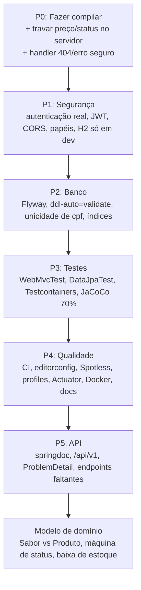

# Auditoria de Profissionalização — SorveteriaBackend

> **Revisada em 2026-10-12** com verificação direta do código-fonte, `pom.xml`,
> árvore de dependências (`mvn dependency:tree`) e histórico git (HEAD `fe76849`
> + working tree). Esta versão **substitui a anterior**, que foi gerada a partir
> do `ROADMAP.md` (05/10) sem revalidar o código e continha itens já corrigidos
> e constatações incorretas.
>
> **Stack:** Java 21 · Spring Boot 4.1.1 · Spring Security 7 · JPA/Hibernate 7 · H2 · Maven.
>
> ⚠️ **Constatação nova desta revisão:** o working tree **não compila**
> (`./mvnw compile` falha — ver P0.1). O HEAD commitado compila normalmente.

**Método de verificação:** `find`/`grep` em `src/`, leitura integral de controllers,
services, DTOs, models, `SecurityConfig`, `GlobalExceptionHandler`,
`application.properties` e `pom.xml`; `mvn dependency:tree`; `git log`/`git diff`;
`./mvnw compile` no working tree e em worktree do HEAD.

**Legenda:** ✅ resolvido/ok · ⚠️ parcial ou com ressalva · 🔴 pendente/crítico.
Prioridades: **P0** imediato · **P1** curto prazo · **P2** curto prazo ·
**P3** médio prazo · **P4** médio prazo · **P5** longo prazo.

---

## 📊 Resumo do Estado Atual

| Camada | Estado |
|--------|--------|
| **Build** | 🔴 Working tree **não compila** (`PedidoController` chama `service.listar(Long)` inexistente) |
| **Arquitetura** | ✅ Sólida (Controller → Service → Repository + DTOs como `record`) |
| **Catálogo (Sabor)** | ✅ CRUD completo com paginação — mas “não encontrado” retorna 500 |
| **Produtos** | 🔴 `ProdutoService` pronto, **sem Controller**; ignora `categoria`/`ativo`; `ProdutoRequest.categoria` é `String` e o campo da entidade é `enum Categoria` |
| **Usuários** | ⚠️ **BCrypt OK**, retorna DTO com CPF mascarado; sem endpoints de listagem/atualização; unicidade com *check-then-insert* (race) |
| **Pedidos** | 🔴 **Brecha crítica** — `POST /pedidos` aceita entidade JPA crua: cliente envia preço, status, `id` e `user`; `PedidoRequest`/`ItemPedidoRequest` existem mas **não são usados** |
| **Segurança** | 🔴 **Sem autenticação nenhuma** — `SecurityFilterChain` existe mas é `permitAll()` total, `JwtAuthenticationFilter` vazio, sem `jjwt`, sem CORS, sem papéis, H2 console global |
| **Banco** | 🔴 H2 em memória, `ddl-auto=update`, sem Flyway, `cpf` sem constraint, unicidade só na aplicação |
| **Testes** | 🔴 Apenas `contextLoads()` — e hoje falharia por falta de compilação |
| **CI/Qualidade** | 🔴 Sem workflows no GitHub Actions, sem `.editorconfig`, sem Spotless, sem profiles, `pom.xml` com metadados vazios |
| **Documentação** | ⚠️ `README.md` (15 KB) e `ROADMAP.md` existem, mas “Problemas conhecidos” e o ROADMAP estão **desatualizados** |

---

## ✅ Já Resolvido (não repetir como pendência)

Itens que constavam como críticos na versão anterior e **já foram corrigidos**
— commits `c510241` e `fe76849` (05/10/2026):

| Item antigo | Estado atual |
|-------------|--------------|
| “Senha gravada em texto puro” | ✅ `UserMapper.toEntity` usa `passwordEncoder.encode(...)` com `BCryptPasswordEncoder` do `SecurityConfig` |
| “Mapper retorna `telefone` no campo `cpf`” | ✅ `toResponse` retorna `user.getCpf()` (máscara `***.***.***-**` no working tree) |
| “`UserController` expõe entidade JPA / vaza `senhaHash`” | ✅ Retorna `UserResponse`; `senhaHash` nunca sai da API |
| “`SecurityFilterChain` ausente — API bloqueada (401)” | ⚠️ A cadeia **existe** e a API **não** está bloqueada — o problema hoje é o inverso: `permitAll()` total (ver seção P1) |
| “README.md ausente” | ✅ `README.md` (15 KB) e `ROADMAP.md` existem — porém com trechos desatualizados (ver seção P4) |

---

## 🔧 Correções em Relação à Versão Anterior

A versão anterior apontava problemas que **não existem mais** ou descrevia
algo diferente do código real. Correções:

| Afirmação anterior | Realidade verificada |
|--------------------|----------------------|
| “Segurança totalmente quebrada — API bloqueada (401)” | Invertido: com `permitAll()`, **nenhum** endpoint exige credencial. O risco hoje é anonimato total, não bloqueio |
| “Senha em texto puro”, “mapper bugado”, “`UserController` expõe entidade” | Resolvidos nos commits `c510241`/`fe76849` (05/10) — ver seção “Já Resolvido” |
| “Migration da coluna órfã `sabor.preco`” | **Cancelado:** `Sabor` não tem mais `preco` (só `nome` + `ativo`) e o único banco é H2 **em memória** — não há coluna órfã persistida. Uma baseline Flyway futura parte do schema atual |
| “`pom.xml` com dependências duplicadas” | Não são duplicatas exatas; são **redundantes**: `spring-data-jpa` e `jakarta.persistence-api` explícitos além dos starters (`dependency:tree` confirma) |
| “Constraints únicas só na aplicação (email, cpf)” | Parcialmente impreciso: `email` tem `@Column(unique = true)` (constraint criada pelo Hibernate via `ddl-auto`); **`cpf` não tem constraint alguma**. Ambos seguem com *check-then-insert* → race condition permanece |
| “Índices ausentes (9 colunas críticas)” | Número não rastreável; substituído abaixo por lista concreta de colunas/FKs |
| “README.md ausente” | Existe — o item agora é **atualizá-lo** (está desatualizado) |

---

## 🚨 CRÍTICO (P0 — Fazer Imediato)

| # | Problema | Evidência / impacto |
|---|----------|---------------------|
| **P0.1** | 🔴 **Working tree não compila** | `./mvnw compile` falha: `PedidoController.java:[35,31] method listar in class com.sorveteria.service.PedidoService cannot be applied to given types; required: no arguments, found: java.lang.Long`. O `GET /pedidos/{id}` (não commitado) chama `service.listar(id)`, que **não existe** em `PedidoService`. O HEAD (`fe76849`) compila — a quebra é das alterações locais em andamento |
| **P0.2** | 🔴 **Pedido aceita preço e estado do cliente** (`PedidoController.criar(@RequestBody Pedido)`) | Fraude direta: cliente envia `itens[].precoUnitario` arbitrário. Pode setar `id` (upsert de pedido existente), `status` (ou deixar `null` — o service nunca valida/atribui), `custoTotal`, `itensTotal` e `user`. `PedidoService.salvar` = `repository.save(pedido)` sem resolução server-side |
| **P0.3** | 🔴 **DTOs de pedido criados mas órfãos** | `PedidoRequest` (`@NotEmpty List<ItemPedidoRequest>`) e `ItemPedidoRequest` (`produtoId` + `quantidade` com `@NotNull`/`@Positive`) existem e são o contrato certo — mas **nenhum arquivo os referencia** além deles mesmos. Só ligar no controller/service |
| **P0.4** | 🔴 **`ProdutoService` ignora `categoria` e `ativo`** | `criar`/`atualizar` copiam só nome/descrição/preço/estoque. `ProdutoRequest.categoria` é `String` mas `Produto.categoria` é `enum Categoria` (**incompatibilidade de tipo**) e `ativo` nunca é setado → produto é salvo com `ativo = false` (default) sem aviso |
| **P0.5** | ⚠️ **`ProdutoRequest.getQuantidade()` lança `UnsupportedOperationException`** | Método morto (`grep` confirma: **nada** o chama hoje), mas é mina: estoura em runtime se chamado/exposto. Remover |
| **P0.6** | 🔴 **`GlobalExceptionHandler` devolve 500 onde deveria 404 e pode quebrar** | `handleGenerico(RuntimeException)` captura `UsuarioNaoEncontradoException`, `"Sabor não encontrado"` e `"Produto não encontrado"` → **500 em vez de 404**. `Map.of(..., e.getMessage(), ...)` lança `NullPointerException` quando a mensagem é `null` (ex.: NPE) — o próprio handler falha |
| **P0.7** | 🔴 **`PedidoController` expõe entidade JPA** | `List<Pedido>`/`Pedido` nas respostas: vaza estrutura interna (`user`, `itens[].produto`, `precoUnitario`) e atrela o contrato da API ao JPA. `UserController` e `SaborController` já retornam DTO — `PedidoController` é o desvio |
| **P0.8** | ⚠️ **Módulo de produtos inteiro inacessível** | `ProdutoService` + `ProdutoRepository` prontos, **`ProdutoController` não existe** (existem só `PedidoController`, `SaborController`, `UserController`). Preço/estoque/categoria não são consumíveis pela API |

---

## 🔐 SEGURANÇA (P1 — Curto Prazo)

> ⚠️ **Correção de leitura:** a versão anterior dizia “API bloqueada (401)”.
> Hoje `SecurityConfig` faz `authorizeHttpRequests(...).anyRequest().permitAll()` —
> **não há autenticação nenhuma**: tudo é anônimo por omissão. O risco mudou de
> “API inutilizável” para “API totalmente aberta”.

| Item | Status | Detalhe |
|------|--------|---------|
| Autenticação real (login + token) | 🔴 Ausente | Nenhum endpoint de login; nenhum fluxo de emissão/validação de JWT |
| `SecurityFilterChain` | ⚠️ Presente | Só `csrf.disable()` + `permitAll()` + `frameOptions(sameOrigin)` — zero autorização |
| `JwtAuthenticationFilter` | 🔴 Classe vazia | `public class JwtAuthenticationFilter {}` — não estende `OncePerRequestFilter`, não é registrado na cadeia |
| Dependências JWT (`jjwt`/Nimbus) | 🔴 Ausentes | Confirmado por `dependency:tree` |
| CORS (`CorsConfigurationSource`) | 🔴 Ausente | Nenhum CORS em `src/` — navegador bloqueia chamadas cross-origin |
| Modelo de papéis (CLIENTE/ADMIN) | 🔴 Ausente | `User` não tem campo de papel/autoridade |
| `@PreAuthorize` nos endpoints sensíveis | 🔴 Ausente | `@EnableMethodSecurity` está habilitado no `SecurityConfig`, mas **nenhuma anotação** o utiliza (habilitação sem efeito) |
| Console H2 restrito a dev | 🔴 Global | `spring.h2.console.enabled=true` + `frameOptions(sameOrigin)` → `/h2-console` acessível em qualquer ambiente |
| Hash de senha | ✅ OK | BCrypt aplicado no `UserMapper`; `UserRequest` exige `@Size(min = 8)` |
| Vazamento de `senhaHash` | ✅ OK | `UserResponse` não o inclui |

---

## 🗄️ BANCO DE DADOS (P2 — Curto Prazo)

| Item | Status | Detalhe |
|------|--------|---------|
| Flyway / Liquibase | 🔴 Ausente | Sem dependência nem `src/main/resources/db/migration`; `ddl-auto=update` em produção é anti-padrão grave (muda schema silenciosamente) |
| Migration `sabor.preco` | 🚫 Cancelado | Entidade `Sabor` só tem `nome`+`ativo` e o H2 é em memória — não existe coluna órfã a migrar |
| Unicidade de `email` | ⚠️ Parcial | `@Column(unique = true)` gera constraint via Hibernate, mas gerida por `ddl-auto`, não por migration versionada |
| Unicidade de `cpf` | 🔴 Inexiste | Sem constraint em lugar nenhum; validação é `existsByCpf` + `save` (*check-then-insert* → race) |
| Índices | 🔴 Ausentes | Nenhum declarado. Colunas candidatas: `users.email`, `users.cpf`, `produto.categoria`, `produto.ativo`, `sabor.ativo`, FKs `pedido.user_id`, `item_pedido.pedido_id`, `item_pedido.produto_id` |
| `@Column` completo | ⚠️ Incompleto | Só `Produto` tem `nullable`/`precision`/`scale`; `User`, `Sabor`, `Pedido`, `ItemPedido` sem restrições |
| Colunas de auditoria | 🔴 Ausentes | Nenhum `createdAt`/`updatedAt` (`User` só tem `ultimoLogin`) |
| H2 em arquivo p/ dev | 🔴 Em memória | `jdbc:h2:mem:sorveteria` — dados perdidos a cada restart; único datasource configurado |

---

## 🧪 TESTES (P3 — Médio Prazo)

| Tipo | Cobertura atual |
|------|-----------------|
| `@DataJpaTest` (repositories) | ❌ Zero |
| `@WebMvcTest` (controllers) | ❌ Zero |
| Integração (Testcontainers + Postgres) | ❌ Zero — `testcontainers` ausente do `pom.xml` |
| Unitário `Pedido.calcularTotal()` | ❌ Zero |
| `@SpringBootTest contextLoads()` | ⚠️ Único teste — e **hoje falharia** porque o código não compila (P0.1) |
| JaCoCo com gate (70%) | ❌ Não configurado |

**Teste mais crítico a escrever:** cliente envia preço forjado → servidor ignora
e usa o preço do banco. Seguidos de: `senhaHash` nunca aparece na resposta e
`GET /pedidos/{id}` inexistente responde 404 (não 500).

---

## ⚙️ QUALIDADE, CI E CONFIG (P4 — Médio Prazo)

| Item | Status | Detalhe |
|------|--------|---------|
| GitHub Actions CI | 🔴 Ausente | `.github/` só contém `modernize/` (scripts de upgrade) — **nenhum workflow** em `.github/workflows/` |
| `.editorconfig` | 🔴 Ausente | Mistura de tabs (controllers antigos) e 4 espaços |
| Spotless + `googleJavaFormat` | 🔴 Ausente | |
| Profiles de ambiente | 🔴 Um único `application.properties` | Sem `application-dev/test/prod`; H2 console e `show-sql=true` ativos em qualquer ambiente |
| `spring.jpa.open-in-view` | ❌ Não configurado | Default `true` (antipadrão) |
| Actuator + Micrometer | 🔴 Ausente | Sem `spring-boot-starter-actuator` no `pom.xml` |
| Dockerfile + docker-compose | 🔴 Ausentes | |
| `pom.xml` metadados | 🔴 Vazios | `<url />`, `<license />`, `<developer />`, `<scm>` vazios; `description` = nome do projeto |
| `pom.xml` redundâncias | ⚠️ Presentes | `spring-data-jpa` e `jakarta.persistence-api` explícitos além de `spring-boot-starter-data-jpa` |
| `README.md` / `ROADMAP.md` desatualizados | ⚠️ Drift | “Problemas conhecidos” do README ainda afirma “API bloqueada (401)” e “senha sem hash” — ambos já corrigidos; ROADMAP (05/10) idem |
| Código morto / nitpicks | ⚠️ Presentes | `UserRepository` importa `Sabor` sem usar; `UserService.listar/atualizar/deletar` sem endpoint; `SaborResponse` expõe componente `Id` (maiúsculo) → JSON sai como `"Id"` |

---

## 🌐 API E DOMÍNIO (P5 — Longo Prazo)

| Item | Status | Detalhe |
|------|--------|---------|
| OpenAPI / Swagger (`springdoc`) | ❌ Ausente | |
| Versionamento (`/api/v1/...`) | ❌ Ausente | Rotas: `/sabores`, `/usuarios`, `/pedidos` |
| Erros padronizados (RFC 9457 `ProblemDetail`) | ❌ `Map.of` ad hoc | Campos `"erro"`/`"mensagem"` inconsistentes entre handlers |
| Paginação limitada | ❌ Não configurado | Sem `default-page-size`/`max-page-size` |
| Nomenclatura unificada | ❌ Misturada | `User` (EN) vs `Sabor`/`Produto`/`Pedido` (PT); `SaborResponse.Id` vs `id` nos demais |
| Endpoints faltantes | ⚠️ Incompletos | `UserController`: só `GET /{id}` e `POST` (sem lista/PUT/DELETE, apesar de `UserService` tê-los); sem `ProdutoController` |
| Máquina de estados `StatusPedido` | ❌ Inexistente | Enum com `PENDENTE/EM_PREPARO/PRONTO/ENTREGUE/CANCELADO`, mas `PedidoService` aceita qualquer `status` (ou `null`) vindo do cliente |
| Baixa de estoque | ❌ Nunca ocorre | Nenhum fluxo altera `Produto.estoque`; `ItemPedido` referencia `Produto` sem movimentação, sem lock e sem checagem de saldo |
| **Decisão: `Sabor` vs `Produto`** | ❌ **Pendente** | `Sabor` = `{nome, ativo}` e `Produto` = `{nome, descricao, preco, estoque, ativo, categoria}` — sobreposição clara; maior custo de reversão |
| Métricas de negócio | ❌ Ausentes | Ticket médio, sabor mais vendido etc. |

---

## 🎯 Ordem Sugerida de Ataque (Caminho Crítico)

---

## ✅ Checklist Prioritário (Top 10 para "Profissional Mínimo")

1. [ ] **Fazer o build compilar**: adicionar `PedidoService.listar(Long)` (ou `buscarPorId`) e alinhar o `PedidoController` em andamento — P0.1
2. [ ] **Migrar `POST /pedidos` para `PedidoRequest`** + `@Valid`: service resolve preço/estoque/status/totais no servidor; nunca aceitar `id`, `precoUnitario` ou `status` do cliente — P0.2/P0.3
3. [ ] **`GlobalExceptionHandler`**: handler tipado → 404 para “não encontrado”, `ApiError` (record) no lugar de `Map.of` para eliminar o NPE com mensagem nula — P0.6
4. [ ] **`ProdutoService`**: setar `categoria` (alinhar `String` ↔ `enum Categoria`) e `ativo`; remover `ProdutoRequest.getQuantidade()` — P0.4/P0.5
5. [ ] **Criar `ProdutoController`** (service e repository já prontos) — P0.8
6. [ ] **Decidir e implementar autenticação**: `SecurityFilterChain` com `permitAll` só em rotas públicas + `JwtAuthenticationFilter` de verdade + dependência JWT + CORS + H2 console só no profile dev — P1
7. [ ] **Flyway + `ddl-auto=validate`**, constraint única para `cpf` (email já tem) e handler `DataIntegrityViolationException` → 409 — P2
8. [ ] **Testes `@WebMvcTest`** nos 3 controllers: preço forjado, não vazamento de `senhaHash`, 404 vs 500 — P3
9. [ ] **CI no GitHub Actions** com `./mvnw verify` (+ Spotless e JaCoCo 70%) — P3/P4
10. [ ] **Atualizar `README.md` (“Problemas conhecidos”) e `ROADMAP.md`** — ambos ainda descrevem 401 e senha em claro — P4

---

## 💡 Recomendação Final

O projeto tem **base arquitetural sólida** (camadas bem separadas, DTOs como
`record`, validação nas bordas, exceções de domínio, transações explícitas em
`SaborService`/`ProdutoService`, injeção por construtor) e **já resolveu a
dívida mais grave** (hash BCrypt + DTO de usuário, em 05/10). O que falta é
**concluir o que foi começado** — os DTOs de pedido já existem e estão prontos,
só falta conectá-los — e depois **endurecer as bordas**: autenticação de
imediato (hoje é tudo anônimo), schema versionado, testes e CI. Dois pontos de
atenção maiores: **decidir `Sabor` vs `Produto`** antes que a API cresça em
cima dos dois, e **atualizar a documentação**, que hoje contradiz o código em
ambas as direções (diz que está quebrado o que já foi corrigido).

---

## 📋 Checklist Completo por Prioridade

### P0 — Bugs e build (fazer primeiro)

- [ ] Fazer o working tree compilar (`PedidoService.listar(Long)` / `buscarPorId` para o novo `GET /pedidos/{id}`)
- [ ] `PedidoController` usa `PedidoRequest` + `@Valid` (DTOs já existem, só conectar)
- [ ] `PedidoService.criar` resolve preço do banco, define `status`, calcula totais e ignora `id`/`user` vindos do cliente
- [ ] `ProdutoService` seta `categoria` (corrigir `String` ↔ `enum Categoria`) e `ativo`
- [ ] Remover `ProdutoRequest.getQuantidade()`
- [ ] `GlobalExceptionHandler`: exceções tipadas de “não encontrado” → 404
- [ ] Substituir `Map.of` por record `ApiError` (elimina NPE com `getMessage()` nulo)
- [ ] Criar `ProdutoController` (service/repository prontos)
- [ ] `PedidoController` retorna DTO, nunca entidade JPA
- [ ] Remover estado duplicado em `Pedido` (`custoTotal`, `itensTotal` — derivar de `calcularTotal()`)

### P1 — Segurança

- [ ] Definir regra real: rotas públicas (`POST /usuarios`, listagens?) vs autenticadas — sair de `permitAll()` total
- [ ] Implementar `JwtAuthenticationFilter` (`OncePerRequestFilter`) e registrá-lo na cadeia
- [ ] Adicionar dependência JWT ao `pom.xml` + endpoint de login
- [ ] Adicionar `CorsConfigurationSource`
- [ ] Modelar papel/autoridade (CLIENTE/ADMIN) em `User`
- [ ] Aplicar `@PreAuthorize` (hoje `@EnableMethodSecurity` está habilitado sem uso)
- [ ] Console H2 e `show-sql` só no profile `dev`

### P2 — Banco

- [ ] Adicionar Flyway e `ddl-auto=validate`
- [ ] `V1__baseline.sql` com o schema atual (sem `sabor.preco` — não existe mais)
- [ ] Constraint única de `cpf` no banco (email já tem via `@Column(unique)`)
- [ ] Handler `DataIntegrityViolationException` → 409
- [ ] Índices: `users.email`, `users.cpf`, `produto.categoria`, `produto.ativo`, `sabor.ativo`, FKs `pedido.user_id`, `item_pedido.pedido_id`, `item_pedido.produto_id`
- [ ] Completar `@Column` (`length`/`precision`/`scale`/`nullable`) em `User`, `Sabor`, `Pedido`, `ItemPedido`
- [ ] Colunas de auditoria `createdAt`/`updatedAt`
- [ ] H2 em arquivo para dev

### P3 — Testes

- [ ] `@DataJpaTest` para `UserRepository` e `SaborRepository`
- [ ] `@WebMvcTest` para os três controllers
- [ ] Teste de preço forjado pelo cliente (o mais crítico)
- [ ] Teste de não vazamento de `senhaHash`
- [ ] Teste de 404 (não 500) para recurso inexistente
- [ ] Testcontainers + Postgres para integração
- [ ] Teste unitário de `Pedido.calcularTotal()`
- [ ] JaCoCo com limite de 70%

### P4 — Qualidade

- [ ] CI no GitHub Actions com `./mvnw verify` (`.github/workflows/` ainda não existe)
- [ ] `.editorconfig` (tabs vs 4 espaços misturados)
- [ ] Spotless com `googleJavaFormat`
- [ ] Separar `application-{dev,test,prod}.properties`
- [ ] `spring.jpa.open-in-view=false`
- [ ] `.env.example`
- [ ] Remover redundâncias do `pom.xml` (`spring-data-jpa`, `jakarta.persistence-api` explícitos)
- [ ] Preencher metadados do `pom.xml`
- [ ] Actuator + Micrometer
- [ ] Dockerfile + docker-compose
- [ ] Atualizar `README.md` (“Problemas conhecidos”) e `ROADMAP.md` — ambos desatualizados

### P5 — API e domínio

- [ ] springdoc OpenAPI + Swagger UI
- [ ] Prefixar rotas com `/api/v1`
- [ ] Migrar erros para `ProblemDetail` (RFC 9457)
- [ ] `default-page-size` e `max-page-size`
- [ ] Padronizar nomenclatura (`User` → `Usuario`; `SaborResponse.Id` → `id`)
- [ ] Completar endpoints: listagem/PUT/DELETE de usuários, `ProdutoController`
- [ ] Máquina de estados de `StatusPedido`
- [ ] Baixa de estoque transacional com checagem de saldo (hoje **nunca** ocorre)
- [ ] **Decidir o modelo `Sabor` vs `Produto`**
- [ ] Métricas de vendas
- [ ] Unificar padrão de estilo dos controllers (`ResponseEntity` vs retorno direto, comentários didáticos)

> **Nota:** os comentários didáticos em português (ex.: explicação de
> `ResponseEntity` em `PedidoController`) e o template NetBeans em
> `ItemPedido`/`Categoria` sugerem material de estudo — se o objetivo é
> publicar como projeto profissional, remova-os ou mova-os para o README.

