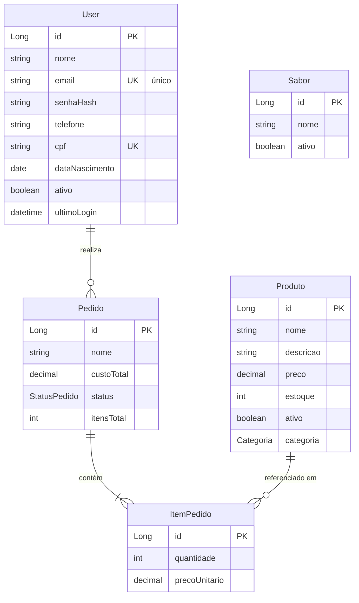

# 🍦 Sorveteria API

Backend REST para uma sorveteria: catálogo de sabores e produtos, cadastro de
clientes e registro de pedidos.

Construído com **Java 21** e **Spring Boot 4.1.1**, com persistência em JPA/Hibernate.

[](https://github.com/omurilomota/Sorveteria-API/actions/workflows/ci.yml)
[](https://openjdk.org/)
[](https://spring.io/projects/spring-boot)
[](https://maven.apache.org/)

---

## 📑 Sumário

- [Sobre](#sobre)
- [Status do projeto](#status-do-projeto)
- [Tecnologias](#tecnologias)
- [Como executar](#como-executar)
- [Configuração](#configuração)
- [Endpoints](#endpoints)
- [Modelo de dados](#modelo-de-dados)
- [Estrutura do projeto](#estrutura-do-projeto)
- [Padrões adotados](#padrões-adotados)
- [Testes](#testes)
- [Problemas conhecidos](#problemas-conhecidos)
- [Contribuindo](#contribuindo)
- [Licença](#licença)

---

## Sobre

API REST que dá suporte a uma operação de sorveteria, cobrindo três áreas:

- **Catálogo** — sabores e produtos com preço, estoque e categoria
- **Clientes** — cadastro com email e CPF únicos
- **Pedidos** — composição de itens com cálculo de total

A arquitetura segue o padrão **Controller → Service → Repository**, com uma
camada de **DTOs** que isola o contrato da API das entidades JPA. Nenhuma
entidade do banco é exposta diretamente nos endpoints — a superfície da API é
composta apenas por `record`s de request e response.

---

## Status do projeto

🚧 **Em desenvolvimento ativo.**

A base arquitetural está completa — camada de DTOs, repositories, tratamento
global de exceção, os quatro controllers, o schema versionado com Flyway e uma
suíte de 30 testes de integração rodando contra PostgreSQL de verdade. A etapa
que falta é a autenticação. Consulte o [ROADMAP](./ROADMAP.md) para o panorama
completo e a ordem sugerida de implementação.

O guia para estudar o código, camada por camada, está em
[GUIA-DE-ESTUDO.md](./GUIA-DE-ESTUDO.md).

| Módulo | Estado |
|---|---|
| Sabor | ✅ CRUD completo com paginação |
| Produto | ✅ CRUD completo, com controller |
| Usuário | ⚠️ Cadastro e busca por ID; autenticação pendente |
| Pedido | ✅ Itens, cálculo de total no servidor e transição de status validada |
| Segurança | ⚠️ Spring Security ativo e senhas em BCrypt, mas **sem autenticação**: o filtro JWT é uma classe vazia e todos os endpoints estão liberados |
| Banco | ✅ PostgreSQL, schema versionado por Flyway e `ddl-auto=validate` |
| Testes | ✅ 30 testes, sendo 29 de integração contra PostgreSQL real |

---

## Tecnologias

| Tecnologia | Versão | Uso |
|---|---|---|
| Java | 21 | Linguagem |
| Spring Boot | 4.1.1 | Framework |
| Spring Web MVC | — | Camada HTTP |
| Spring Data JPA | — | Persistência |
| Spring Security | — | Segurança e hash de senha (autenticação pendente) |
| Spring Validation | — | Validação de entrada |
| PostgreSQL | 18 | Banco de dados |
| Flyway | 12.x | Versionamento do schema |
| Testcontainers | 2.x | PostgreSQL descartável nos testes |
| Hibernate | 6.x | ORM |
| Lombok | — | Redução de boilerplate |
| JUnit 5 | — | Framework de testes |
| Maven | — | Build |

---

## Como executar

### Pré-requisitos

- **Java 21** ou superior
- **Maven 3.9+** (ou use o wrapper `./mvnw`, que já vem no projeto)

### Passo a passo

```bash
# 1. Clone o repositório
git clone https://github.com/omurilomota/Sorveteria-API.git
cd Sorveteria-API

# 2. Suba a aplicação
./mvnw spring-boot:run
```

Ou, se preferir via JAR:

```bash
./mvnw clean package
java -jar target/SorveteriaBackend-0.0.1-SNAPSHOT.jar
```

### Banco de dados

A aplicação usa PostgreSQL. Para rodar local, suba um com Docker:

```bash
docker run -d --name sorveteria-db \
  -e POSTGRES_DB=sorveteria \
  -e POSTGRES_USER=sorveteria \
  -e POSTGRES_PASSWORD=sorveteria \
  -p 5432:5432 postgres:18-alpine
```

O Flyway cria as tabelas sozinho na primeira subida da aplicação. Para conferir
depois:

```bash
docker exec -it sorveteria-db psql -U sorveteria -d sorveteria -c '\dt'
```

### Acessos

| Serviço | URL |
|---|---|
| API | http://localhost:8081 |
| Documentação (Swagger UI) | http://localhost:8081/swagger-ui.html |

Para apontar para outro banco, use as variáveis `DB_URL`, `DB_USER` e
`DB_PASSWORD`. Os valores padrão (para desenvolvimento local) estão em
`application.properties`.

---

## Configuração

Toda a configuração está em `src/main/resources/application.properties`:

| Propriedade | Valor | Descrição |
|---|---|---|
| `server.port` | `8081` | Porta da aplicação |
| `spring.datasource.url` | `jdbc:postgresql://localhost:5432/sorveteria` | Banco (aceita `DB_URL`) |
| `spring.datasource.username` | `sorveteria` | Usuário (aceita `DB_USER`) |
| `spring.datasource.password` | `sorveteria` | Senha (aceita `DB_PASSWORD`) |
| `spring.jpa.hibernate.ddl-auto` | `validate` | Confere as entidades contra o schema; não altera nada |
| `spring.flyway.enabled` | `true` | Aplica as migrações de `db/migration` |
| `spring.jpa.show-sql` | `true` | Loga as queries |
| `spring.jpa.properties.hibernate.format_sql` | `true` | SQL formatado nos logs |

> ⚠️ **Nunca edite uma migração que já foi aplicada.** O Flyway guarda um
> checksum de cada arquivo: alterar um arquivo aplicado faz a próxima subida
> falhar. Mudança nova é arquivo novo (`V2__...`, `V3__...`).
---

## Endpoints

Base: `http://localhost:8081`

> ⚠️ **Todos os endpoints estão liberados, sem autenticação.** O `SecurityConfig`
> define uma cadeia de filtros com `anyRequest().permitAll()`, e o
> `JwtAuthenticationFilter` é uma classe vazia que ninguém referencia. Isso serve
> apenas enquanto a autenticação não existe — não é configuração para produção.

### Sabores

CRUD completo, com paginação e ativação/desativação.

| Método | Rota | Descrição | Retorno |
|---|---|---|---|
| `GET` | `/sabores` | Lista paginada | `200` · `Page<SaborResponse>` |
| `GET` | `/sabores/ativos` | Lista apenas ativos | `200` · `List<SaborResponse>` |
| `GET` | `/sabores/{id}` | Busca por ID | `200` · `SaborResponse` |
| `POST` | `/sabores` | Cria um sabor | `201` · `SaborResponse` |
| `PUT` | `/sabores/{id}` | Atualiza um sabor | `200` · `SaborResponse` |
| `PATCH` | `/sabores/{id}/status?ativo={bool}` | Altera o status | `204` |
| `DELETE` | `/sabores/{id}` | Remove um sabor | `204` |

<details>
<summary>Exemplos de requisição</summary>

Criar sabor:

```bash
curl -X POST http://localhost:8081/sabores \
  -H "Content-Type: application/json" \
  -d '{"nome": "Chocolate Belga"}'
```

```json
{
  "id": 1,
  "nome": "Chocolate Belga",
  "ativo": true
}
```

Listar com paginação:

```bash
curl "http://localhost:8081/sabores?page=0&size=20&sort=nome,asc"
```

Desativar sem remover:

```bash
curl -X PATCH "http://localhost:8081/sabores/1/status?ativo=false"
```

</details>

### Usuários

| Método | Rota | Descrição | Retorno |
|---|---|---|---|
| `GET` | `/usuarios/{id}` | Busca por ID | `200` · `User` |
| `POST` | `/usuarios` | Cria um usuário | `200` · `UserResponse` |

<details>
<summary>Exemplo de requisição</summary>

```bash
curl -X POST http://localhost:8081/usuarios \
  -H "Content-Type: application/json" \
  -d '{
    "nome": "Ana Souza",
    "email": "ana@exemplo.com",
    "senha": "minhasenha123",
    "telefone": "11987654321",
    "cpf": "12345678901",
    "dataNascimento": "1995-03-15"
  }'
```

Campos validados: `nome` e `email` e `senha` são obrigatórios, `senha` exige
mínimo de 8 caracteres, `email` precisa ter formato válido, `cpf` exatamente 11
dígitos, `telefone` 10 ou 11 dígitos e `dataNascimento` no passado.

</details>

### Pedidos

| Método | Rota | Descrição | Retorno |
|---|---|---|---|
| `GET` | `/pedidos` | Lista todos | `200` · `List<Pedido>` |
| `POST` | `/pedidos` | Cria um pedido | `200` · `Pedido` |

> ⚠️ Estes endpoints ainda recebem e devolvem a **entidade JPA**. A migração
> para DTO está especificada no [ROADMAP](./ROADMAP.md#03--pedidocontroller-aceita-a-entidade-jpa-crua).

---

## Modelo de dados



### Entidades

| Entidade | Papel |
|---|---|
| `User` | Cliente, com endereço embutido (`@Embeddable Endereco`) |
| `Pedido` | Pedido, com status e lista de itens |
| `ItemPedido` | Item do pedido, referencia produto e guarda o preço unitário |
| `Produto` | Item do catálogo: preço, estoque e categoria |
| `Sabor` | Sabor do catálogo, hoje apenas `nome` e `ativo` |

### Enums

```java
public enum StatusPedido { PENDENTE, EM_PREPARO, PRONTO, ENTREGUE, CANCELADO }

public enum Categoria    { SORVETE, ACAI, BEBIDA, SOBREMESA, OUTRO }
```

> 📌 Sobre a modelagem: `Sabor` e `Produto` hoje se sobrepõem, e `Pedido`
> mantém `custoTotal` e `itensTotal` em paralelo a `calcularTotal()` e
> `itens.size()`. A consolidação desse modelo está detalhada no
> [ROADMAP](./ROADMAP.md#58-decisão-de-modelagem-pendente-sabor-vs-produto).

---

## Estrutura do projeto

```
src/
├── main/
│   ├── java/com/sorveteria/
│   │   ├── SorveteriaBackendApplication.java   # Entry point
│   │   ├── SecurityConfig.java                  # Configuração de segurança
│   │   ├── JwtAuthenticationFilter.java         # Filtro de token JWT
│   │   ├── controller/                          # Camada HTTP
│   │   │   ├── SaborController.java
│   │   │   ├── UserController.java
│   │   │   └── PedidoController.java
│   │   ├── service/                             # Regras de negócio
│   │   │   ├── SaborService.java                # Interface
│   │   │   ├── SaborServiceImpl.java            # Implementação
│   │   │   ├── UserService.java
│   │   │   ├── ProdutoService.java
│   │   │   └── PedidoService.java
│   │   ├── repository/                          # Acesso a dados
│   │   │   ├── SaborRepository.java
│   │   │   ├── UserRepository.java
│   │   │   ├── ProdutoRepository.java
│   │   │   └── PedidoRepository.java
│   │   ├── model/                               # Entidades JPA
│   │   │   ├── User.java
│   │   │   ├── Pedido.java
│   │   │   ├── ItemPedido.java
│   │   │   ├── Produto.java
│   │   │   ├── Sabor.java
│   │   │   ├── StatusPedido.java
│   │   │   └── Categoria.java
│   │   ├── dto/                                 # Requests e responses
│   │   │   ├── SaborRequest.java        SaborResponse.java
│   │   │   ├── ProdutoRequest.java      ProdutoResponse.java
│   │   │   ├── UserRequest.java         UserResponse.java
│   │   │   ├── PedidoRequest.java       ItemPedidoRequest.java
│   │   │   └── UserMapper.java
│   │   └── exception/                           # Exceções e handler global
│   │       ├── GlobalExceptionHandler.java
│   │       ├── UsuarioNaoEncontradoException.java
│   │       ├── EmailJaCadastradoException.java
│   │       └── CpfJaCadastradoException.java
│   └── resources/
│       └── application.properties
└── test/
    └── java/com/sorveteria/
        └── SorveteriaBackendApplicationTests.java
```

---

## Padrões adotados

### DTOs como `record`

Todo o contrato da API usa `record`, imutável e sem boilerplate. Entidades JPA
nunca são recebidas nem devolvidas, exceto nos endpoints pendentes de migração.

```java
public record SaborRequest(
    @NotBlank String nome
) {}
```

### Bean Validation nas bordas

A entrada é validada com `jakarta.validation` antes de chegar ao service.

```java
@PostMapping
@ResponseStatus(HttpStatus.CREATED)
public SaborResponse criar(@RequestBody @Valid SaborRequest dto) {
    return service.criar(dto);
}
```

### Tratamento global de exceção

`GlobalExceptionHandler` traduz exceções de domínio em respostas HTTP
padronizadas.

| Exceção | Status | Situação |
|---|---|---|
| `MethodArgumentNotValidException` | `400` | Payload inválido |
| `EmailJaCadastradoException` | `409` | Email duplicado |
| `CpfJaCadastradoException` | `409` | CPF duplicado |
| `RuntimeException` | `500` | Erro genérico |

```json
{
  "status": 409,
  "erro": "Conflito",
  "mensagem": "Email já cadastrado: ana@exemplo.com",
  "timestamp": "2026-10-05T10:21:56.031Z"
}
```

### Transações explícitas no service

```java
@Transactional(readOnly = true)
public List<SaborResponse> listarAtivos() { ... }

@Transactional
public SaborResponse criar(SaborRequest dto) { ... }
```

### Injeção por construtor

Preferência por `@RequiredArgsConstructor` do Lombok com campos `final`, o que
torna as dependências explícitas e permite injeção imutável.

### Query methods do Spring Data

Nomes de método auto-descritivos dispensam JPQL na maioria dos casos.

```java
public interface SaborRepository extends JpaRepository<Sabor, Long> {
    List<Sabor> findByAtivoTrue();
}
```

---

## Testes

```bash
./mvnw test
```

São 30 testes, quase todos de integração: sobem a aplicação inteira com
`@SpringBootTest`, disparam requisições HTTP com `MockMvc` e conferem a resposta.

O banco é um PostgreSQL real, criado na hora pelo Testcontainers e descartado no
final, então **é preciso ter Docker rodando**. Isso é de propósito: teste contra
banco em memória valida um banco que não é o seu.

Cada teste roda dentro de uma transação revertida ao terminar, então não há
dependência de ordem entre eles.

Cobrem: os quatro controllers, os caminhos de erro (`404`, `400`, `409`), a
máscara de CPF na resposta e a máquina de transição de status dos pedidos.

---

## Limitações atuais

A lista completa e priorizada fica no [ROADMAP](./ROADMAP.md). Aqui estão apenas
as que afetam quem for usar a API hoje.

### ⚠️ Não há autenticação

`SecurityConfig` libera todos os endpoints com `anyRequest().permitAll()`, e o
`JwtAuthenticationFilter` é uma classe vazia. Quem alcançar a API pode ler e
escrever. **Não exponha esta aplicação na internet enquanto isso não for
implementado.**

### ⚠️ As listagens não seguem o mesmo contrato

`GET /sabores` devolve um `Page` do Spring (`content`, `pageable`,
`totalElements`), enquanto `GET /produtos` e `GET /pedidos` devolvem um array
puro. Os três deveriam responder no mesmo formato.

### ⚠️ CPF duplicado só é impedido no código Java

`UserService` verifica se o CPF já existe antes de salvar, mas não há constraint
`UNIQUE` para `cpf` no banco. Duas requisições simultâneas podem passar pela
verificação ao mesmo tempo e gravar duplicado. O e-mail tem constraint e não
sofre disso.

### ⚠️ Colunas que aceitam nulo sem precisar

`users.nome` e `produto.categoria`, entre outras, são `varchar` sem `NOT NULL`,
porque a entidade não declara `@Column(nullable = false)`. A validação de
entrada cobre o caso normal, mas o banco aceitaria nulo.

---

## Contribuindo

1. Crie uma branch a partir de `master`:
   ```bash
   git checkout -b feat/minha-feature
   ```
2. Faça suas alterações seguindo os padrões já existentes no código
3. Rode a build e os testes antes de abrir o PR:
   ```bash
   ./mvnw clean verify
   ```
4. Abra o Pull Request descrevendo a mudança

O projeto adota **Conventional Commits**:

```
feat: adiciona baixa de estoque na confirmação do pedido
fix: corrige mapeamento de telefone no response de usuário
refactor: extrai mapeamento de Pedido para PedidoMapper
chore: configura profiles de dev e prod
```

---

## Licença

Projeto em desenvolvimento. Defina a licença antes de publicar.

---

<div align="center">

**[⬆ Voltar ao topo](#-sorveteria-api)**

Feito com ☕ para quem prefere sorvete a mais

</div>
